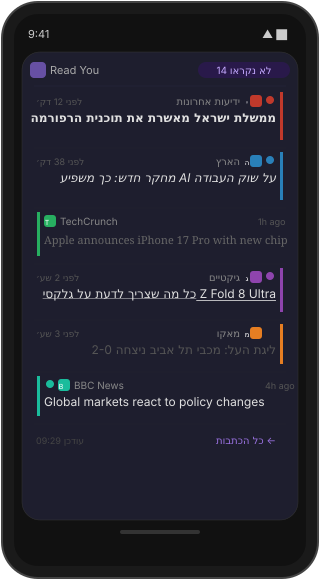
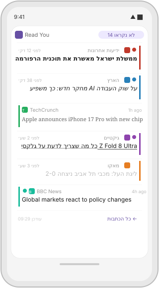
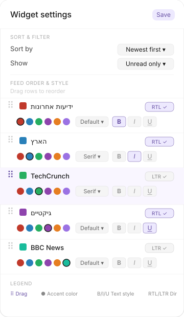

# NewsFeed Widget

A standalone Android home screen widget that fetches and displays RSS/Atom feeds directly on your home screen — no companion app required. Built for full **RTL Hebrew support** and designed for the **Galaxy Z Fold** inner display.

One widget, two tap behaviors: **NewsFeed** expands an article in place when you tap it, or, per widget in Settings, enlarges it (**Focus** mode) for reading one article at a time. There is a single "NewsFeed" entry in the "Add widget" picker.

---

## Screenshots

<table>
  <tr>
    <td align="center"><b>Amethyst theme</b></td>
    <td align="center"><b>Lavender theme</b></td>
    <td align="center"><b>Config panel</b></td>
  </tr>
  <tr>
    <td></td>
    <td></td>
    <td></td>
  </tr>
  <tr>
    <td align="center"><sub>Mixed Hebrew RTL + English LTR<br>feeds with per-feed accent colors</sub></td>
    <td align="center"><sub>Same layout in Lavender theme</sub></td>
    <td align="center"><sub>Long-press widget → Edit widget<br>Drag ⠿ to reorder · × to remove</sub></td>
  </tr>
</table>

---

## How it works

The widget is **fully standalone** — it fetches RSS/Atom feeds directly over the network using OkHttp. You add feed URLs yourself, search for feeds by topic, or import them from an OPML file exported by Feedly, Reeder, or any other RSS reader.

---

## Features

### Feed display
- Shows latest RSS/Atom articles directly on the home screen
- **Colored circle icon** with the feed's initial letter at the start of each article row
- Unread/total count badge in the widget header, scoped to what's actually on screen (not the full accumulated history)
- Unread dot indicator per article
- Per-feed colored left/right accent stripe matching the circle icon
- Article **date and time** — shows `HH:mm` for today's articles, `dd/MM HH:mm` for older ones
- Refresh countdown in the footer (`↻ in Xmin` / `↻ <1min`) — auto-updates every 60 seconds without any interaction; tap to refresh immediately
- **Settings button** (⚙) in the footer row opens the widget config screen directly from the widget

### Scrollable article list
The widget uses a scrollable list — swipe up and down within the widget to browse articles without leaving the home screen. The number of rows shown at once is computed from real per-row memory cost (not a flat guess), and a **Load more articles ↓** button at the bottom reveals more of your accumulated history in chunks as you need them. When "Showing X of Y" appears at the bottom instead (X and Y count articles, the same unit as the header's number: X equals the header's total, and a folded thread's hidden reports are counted in both), that's a real ceiling: either the device's bitmap memory (a smaller font size raises that one) or the size of the update the widget can hand to the launcher (about 36 typical rows in any theme; a smaller font does not raise that one, and the line then reads "the widget can't show more at once" instead of suggesting a smaller font).

### Tap to read inline
Tapping an article title expands it inside the widget:
- Article description or full page content appears below the title
- **Open article →** button appears to open the full article externally
- Tap the expanded article again to collapse it

*(With **When I tap an article** set to **Focus (enlarge)** in Settings, tapping instead enlarges the article — see [Focus Mode](#focus-mode) below.)*

### Article length modes
| Mode | Setting label | Description |
|---|---|---|
| Short | Subtitle only | Up to 100 characters of the RSS excerpt |
| Medium | First paragraph | Up to 400 characters of the RSS excerpt (default) |
| Full | Full article | Fetches the full web page content on demand — tap **Load full article ↓** to fetch |

In **Full** mode, the widget fetches the article's web page and extracts the real body content using a proper HTML parser (Jsoup): it strips navigation, scripts, ads/promo blocks, and embedded widgets by both tag and by class/id pattern-matching, then pulls text only from actual paragraph/heading/list elements — not whatever happens to be near them in the page markup. Content reveals in chunks — tap **Load more ↓** to keep reading, with an **Open in browser ↗** link next to every chunk so you can jump to the source without scrolling back down. The fetched content is cached for the current widget session.

### Open article externally
The "Open article in" setting controls where the Open button sends you:
- **Browser** — opens in your default web browser (default)
- **Share sheet** — share the article URL to any app

An article is **marked as read** once you move on to another one (expanding a different article, or focusing a different one in Focus mode) — not the moment you press it. Articles with no description have nothing to expand, but follow the same rule: they are marked read when you tap a different article.

### Sort options
| Option | Description |
|---|---|
| Newest first | Latest articles at the top (default) |
| Oldest first | Oldest articles at the top |
| By feed | Round-robin interleave — one article per feed per round, equal representation |
| Unread first | Unread articles always shown above read ones |

### Filter options
| Option | Description |
|---|---|
| All | Show every article |
| Unread only | Show only articles you haven't read yet |
| Read only | Show only articles you've already read |

### Story threads (group similar stories)

When several feeds report the same news story within a few hours (for example ynet, N12, Kan and a Telegram channel), the widget shows it as **one row**: the newest report, with a small **+N** badge at the end of its meta line (N = the other reports). Tap the badge to list the other reports right under it (the badge turns into a **−**; tap it again to fold them away). While a thread is open, a **timeline** down the right edge shows that the lead and its reports belong together: one dot per article joined by a thin vertical line, a hollow dot on the newest article (the lead) and filled dots on the other reports, the line ending at the last report. A folded thread shows just the hollow dot next to its +N badge. The dividers between the rows of an open thread are thinner than between unrelated stories. Tapping the row itself works as usual for your tap mode.

- **Matching** is by the key words of the headline (punctuation, quotes, niqqud and common Hebrew/English filler words ignored), across **different** feeds, within 6 hours, needing at least 3 shared key words covering 60% of the shorter headline, at least 2 of them real content words. Reporter names (the signature a Telegram channel puts at the start of its posts), channel labels such as "צ'אט כתבים" or "מבזקן 12", and words that recur all day long ("נתניהו", "יום") do not count, so two headlines that only share a reporter, a channel or the names of the day are not grouped. Up to 12 reports per thread; the newest is the lead. Headlines that are worded very differently are not grouped.
- **Reading:** a thread is marked read as a whole when you move on from any of its articles to something outside it (moving between its own articles marks nothing). Under **Unread only** the whole thread then fades out and disappears together. A later report of the same story starts a new unread thread.
- **Counts:** the header badge still counts articles; the row limit and **Load more** count rows (a folded thread is one row). A thread you open at the very bottom of a full list is never left empty: its reports are added past the limit, as far as the update-size ceiling (about 45 typical rows in all) and, in Glamour, the bitmap limit allow.
- **Switch it off per widget** in Settings → Sort & Filter → **Group similar stories** (on by default). Off shows every article as its own row, as before.

### Default feeds
Under **Add Feed** in Settings, **Add default feeds** merges the bundled starter feeds into your list without duplicating any you already have, and **Reset to defaults** (with a confirmation) replaces your whole list with them; both apply when you tap Save.

The bundled list (11 feeds): ynet - מבזקים, ynet - חדשות, וואלה - מבזקים, גלובס - כל הכתבות, גלובס - בארץ, N12 צ'אט הכתבים and חדשות N12 (Telegram channels), כאן חדשות - חדשות, MIT Technology Review - AI, AI Newsletter and The Hindu - Tech.

**Plain `http://` feed addresses.** The app does not allow unencrypted (cleartext) connections, so every `http://` feed address is fetched as `https://` instead (only the scheme changes; the address you typed stays in your list). The same happens when you add, edit or import a feed: it is stored as `https://`, and an `http://` and an `https://` address of the same feed count as one feed (so "Add default feeds" does not duplicate The Hindu if your list has its old `http://` address). If a site cannot be reached over https, the refresh log says `https upgrade of http feed: ...`.

### Find feeds by topic
A search box in Settings looks up feeds by topic, site name, or keyword (via Feedly's public feed-search index) and lists title, description, and subscriber count for each result — tap **+ Add** to add one directly, no need to already know its URL.

### Telegram channels as a feed source
Public Telegram channels can be added through the same **Add Feed** field used for RSS/Atom URLs — just type one of:
- `@channelname`
- `t.me/channelname` or `https://t.me/channelname`
- `telegram.me/channelname`
- a direct `t.me/s/channelname` preview URL (e.g. pasted straight from a browser)

The app recognizes any of these, canonicalizes them to the channel's public `https://t.me/s/<channel>` preview page, and scrapes that page — a public, no-login HTML view every Telegram channel exposes. No Telegram account, bot token, or API key is involved. Once added, a Telegram channel behaves exactly like any other feed: it accumulates articles, refreshes on the normal schedule, and supports every per-feed customization (accent color, font, RTL/LTR, etc.).

Each post's first two lines become the article's headline (joined into one line so it wraps naturally instead of hard-breaking); the rest becomes the description (up to Telegram's 4096-character limit; a headline longer than 200 characters is cut at a word boundary and the overflow continues at the start of the description, so no text is lost or repeated). Telegram behaves like any other feed except there is no "Load full article" button, since the post text is already complete. Older already-stored posts keep their stored text until they scroll out of the channel's preview window. A photo-only post with no caption falls back to the channel's name as its title instead of being dropped. There's no pagination — the first add pulls whatever's on the channel's preview page (its most recent posts), and the accumulated history grows over time through normal refreshes like any other feed. Private channels and invite links (`t.me/joinchat/...`, `t.me/+...`) aren't supported, since they aren't public pages.

### Per-feed customization
Every feed can be configured independently:

#### Accent color
Each feed is automatically assigned a distinct color from a 12-color palette (the palette itself changes to match your chosen widget theme) when first added. You can change it manually in Settings by tapping the color swatch. The color is used for the circle icon, article stripe, source label, and unread dot — unless "Use theme accent colors" is on, which hides all per-feed colors in favor of one theme-wide accent.

#### Font
| Option | Best for |
|---|---|
| Default | General news, system sans-serif |
| Serif | Editorial / newspaper-style feeds |
| Mono | Tech, code, or developer feeds |

#### Text style
Apply any combination of **Bold**, *Italic*, and <u>Underline</u> to a feed's headlines.

#### Text direction (RTL / LTR)
Each feed has its own direction toggle. RTL flips the entire card: stripe moves to the right, source name aligns right, timestamp moves left. Mix RTL and LTR feeds in the same widget simultaneously — this is independent of your device's system language.

#### Display mode (TXT / IMG)
In image mode, a thumbnail is pre-fetched from the RSS feed's image tags (`<media:thumbnail>`, `<media:content>`, `<enclosure>`, or the first `` in the article description) and cached locally. The thumbnail scales with your font size setting.

### Font size (two independent sliders)
- **Font size** — scales headlines, meta text, and the header/footer from 50% to 300%.
- **Article font size** — scales the expanded article body text (description or full-article content) independently, also 50% to 300%. Kept separate because a comfortable headline size and a comfortable reading size for paragraphs of body text aren't usually the same number.

### Widget themes
Ten built-in options, each with a distinct light and dark variant selectable independently of the system theme:

| Theme | Character | Default |
|---|---|---|
| Auto | Follows the system light/dark setting (Material You) | |
| Lavender | Soft lavender editorial — light purple palette | |
| Amethyst | Rich amethyst — deep purple dark palette | |
| Glassy | Frosted glass with 3D depth, semi-transparent surface | |
| Simple | Pure black and white, no color | |
| Aerospace | Amber on near-black charcoal — mission-control feel | |
| Data Science | Teal-mint on deep navy — silicon-lab precision | |
| Glamour | Warm cream/beige with Playpen Sans Hebrew handwriting headlines | ★ |
| Black & White | Pure black and white only, with no intermediate grays anywhere — starker and higher-contrast than Simple, which still uses gray for containers and muted text | |
| Custom | Pick your own font and background colors (see [Custom theme colors](#custom-theme-colors) below) | |

**Default on first install:** Glamour theme · Light variant · Accent colors on.

Only Glamour renders headlines and article text as custom bitmaps (see below) — every other theme uses plain system-font text with no bitmap-memory cost, so their row limit is governed only by a flat safety ceiling (300 rows) rather than the more conservative, size-dependent budget Glamour's bitmaps need.

### Glamour Hebrew handwriting font
Glamour uses **Playpen Sans Hebrew** (from [Google Fonts](https://fonts.google.com/specimen/Playpen+Sans+Hebrew), by TypeTogether, bundled in both `res/font/` and `assets/fonts/`) for article headlines and body text — a marker-style handwriting face with full native coverage of both Hebrew and Latin scripts in the same family, in real regular and bold weights. English text embedded mid-sentence (site names, abbreviations) renders in the exact same face and weight as the surrounding Hebrew — no fallback typeface needed.

Because Jetpack Glance/RemoteViews cannot load `R.font` resources directly, headlines and body text are rendered to a `Bitmap` via Android Canvas (`StaticLayout` + `TextPaint`) and displayed as an `Image` composable inside the widget, tinted to the theme's ink color at display time rather than baked into the bitmap. Text direction is set explicitly via `TextDirectionHeuristics.RTL`/`LTR` with `Layout.Alignment.ALIGN_NORMAL`. The bitmap renderer uses a 40-entry LRU cache keyed on text + size + width + direction + weight.

### Custom theme colors
Selecting **Custom** as the widget theme reveals two color pickers in Settings — **Font color** and **Background color** — each controlled by three sliders (Red / Green / Blue, 0–255) with a live circular swatch preview next to the label. There's no hex-code typing involved; the sliders are the only input.

The existing **Theme variant** (Light/Dark) toggle is reused for Custom instead of needing a second pair of colors: Light uses the two picked colors as-is (background = your background color, text = your font color), and Dark automatically swaps them — the picked background color becomes the text color and vice versa. Everything else that's normally theme-driven (the settings-gear icon, footer text, unread badge, dividers) is derived from the same two colors at different opacities rather than being separately configurable.

### Focus Mode

Focus is a per-widget setting, not a separate widget. In **Widget settings → When I tap an article**, choose **Focus (enlarge)** (the default is **Expand in place**). It is for browsing by tapping through articles one at a time rather than scrolling a list. Switching the setting on a placed widget takes effect on **Save** and resets that widget's expanded/focused article.

> **Upgrading from the separate NewsFeed Focus widget:** that widget no longer exists, and the update removes any placed Focus widget from your home screen. Add the **NewsFeed** widget again and set **When I tap an article** to **Focus (enlarge)**.

- **Tap any article** to focus it: that row enlarges, every other row stays at its normal size, and the article's description/full text auto-expands inline — no separate expand tap needed. Tapping the focused row again clears focus. The list stays where you scrolled it, so the enlarged row is right where you tapped, also for the last row.
- **Header controls** (only shown in Focus mode):
  - **N/M** — a position indicator showing where the focused article sits among what's currently on screen.
  - **− / +** — adjust how big the focused row is (0.75× – 2.5×) live. The zoom you choose is remembered per widget: it stays when you tap a different article, clear focus, refresh, switch between Expand and Focus, or restart the phone, and only changes when you press − or + again.
- Everything else (feeds, sort, filter, theme, refresh, self-update) is shared with Expand mode — Focus only changes how you browse, not what's fetched or shown.

### Self-updating

The widget can check for and install a newer build directly, without manually re-downloading the APK.

- **Automatic daily check** — runs once a day in the background; if a newer build is available, you get a system notification. Tapping it downloads the update and hands it straight to Android's own install screen.
- **Manual check** — the **APP UPDATE** section in Settings shows your current build number and a **Check now** button that checks immediately instead of waiting for the daily cycle.
- The very first time you install an update this way, Android will show its own "install unknown apps" permission screen (and possibly a Google Play Protect "app not recognized" prompt) — this is expected for an app outside the Play Store and only needs granting once per widget package.
- On Android 13+, checking for updates also requests notification permission the first time (needed only for the daily check's notification) — declining it is fine, the manual "Check now" button still works either way.

### Crash detection & bug reports
The app detects its own crashes: an uncaught-exception handler installed at startup logs any crash locally before handing it back to Android's own handler — this is purely additive observation and never suppresses, intercepts, or changes how a real crash is handled or how the process restarts.

Logged crashes show up in a **BUG REPORTS** section in Settings, grouped by exception type and message so repeated occurrences of the same crash count as one entry, not many. Each entry shows:
- A **Solved** / **Unsolved** badge — "Solved" means that crash signature hasn't recurred since a newer build was installed (derived automatically from build numbers, not manually tracked — so a crash that simply hasn't happened again yet can show as "Solved" even if it wasn't actually fixed).
- How many times it's occurred and when it was last seen.

Every stored crash (build number, timestamp, exception type/message and the stack trace) is included in the problem report described in [Reporting a problem](#reporting-a-problem), which you can share at any time, with or without a crash.

This is entirely local and on-device — nothing is sent anywhere automatically. There is no background upload and no crash-reporting service; a crash only ever leaves the phone inside a problem report that you choose to share or send (Share, or Send to developer in builds that have it), never by itself.

### Reporting a problem
Something not working, for example the footer says `⚠ 2 failed`? Open **Settings**, scroll to the bottom and tap **REPORT A PROBLEM** to open it (the whole area, including the crash list and the refresh log, stays collapsed until you open it, so it never gets in your way). It is always available, crash or not:
- Optionally describe what you saw (**What did you see?**), then tap **Preview report** to read exactly what would be shared, or **Share report** to hand it to the Android share sheet (email, Drive, a messaging app, ...) as a plain text file named `newsfeed-report-<date>-<time>.txt` (the time includes the seconds, so two reports never overwrite each other).
- **Send to developer** (in builds that were given a server address, see [docs/REPORT_SERVER.md](docs/REPORT_SERVER.md); otherwise the button is not shown) sends the same report straight to the developer's server. It first shows you what will be sent (with a warning only if you ticked **Include my feed addresses**; the server address is not shown), with a **Preview first** option, and only the **Send** button sends. You get a report number to quote when you contact the developer (`Sent. Report #42 — ...`), and a `Last sent: <time> (#42)` line under the buttons; a second send is blocked for a minute. If the server cannot be reached or says no, the app tells you and suggests **Share report**; it never retries by itself.
- The report contains: the app build, your phone model and Android version, language and time zone, your note, the settings of each widget (tap behavior, filter, sort, theme, refresh interval, retention and so on), the feed **names**, the refresh status (last successful refresh, last attempt, how many feeds failed), the last 20 refreshes with, for every feed that failed, why (HTTP code, timeout, DNS or network error, not a feed ...), and any recorded crashes with their stack traces.
- **Feed addresses (URLs) are left out unless you tick Include my feed addresses** (off by default). When ticked, user names, passwords and the values of token, key or session style parameters in the addresses are replaced by `REDACTED`. The same applies to your note: an address you type there is replaced by `<address>` (or redacted when the box is ticked).
- Optionally fill in **Send reports to (email)** once; the share sheet then pre-fills that recipient. The field is empty by default and the app contains no address of its own.
- **Nothing is sent automatically.** The app never uploads anything in the background; a report leaves the phone only when you tap **Share report** and pick a destination, or tap **Send** in the Send to developer confirmation. Report files are kept in the app's cache and deleted after 7 days.
- **What the developer's server keeps** (only for reports you send): the report text, a random id made once for your install (not linked to your phone or account), the app build, the time, and a hashed form of your IP address for rate limiting. Reports are deleted after 180 days. Details and the exact format are in [docs/REPORT_SERVER.md](docs/REPORT_SERVER.md).

The **LAST REFRESHES** list in Settings shows the same log on the phone: one row per refresh (`HH:mm · trigger · 6/8 feeds OK`, amber when a feed failed); tap a row to see each feed's result and reason. The log keeps the last 50 refreshes in a local file and never leaves the device unless you share a report. A footer that says `⚠ N failed` means N feeds failed in the last refresh; open LAST REFRESHES to see which and why.

### Feed management
- **Add by URL** — paste any RSS or Atom feed URL, or a Telegram channel reference (see [Telegram channels as a feed source](#telegram-channels-as-a-feed-source) above); the field's placeholder reads "RSS, Telegram or Atom feed URL". The widget fetches and validates the feed/channel title automatically
- **Find feeds** — search by topic/keyword instead of already knowing a URL (see above)
- **Import OPML** — import feeds from any OPML file (grouped and flat OPML supported)
- **Export OPML** — share your current feed list as a standard OPML 2.0 file
- **Edit** — tap a feed's name to change its display name or URL
- **Drag to reorder** — drag feeds in the config screen (via the ⠿ handle) to control their display order
- **Remove** — tap × on any feed row to delete it

### Article accumulation
The widget merges freshly fetched articles with previously stored ones (up to 300 total, deduplicated by ID, sorted by date). Articles stay available even between refreshes. A feed's very first fetch pulls its whole available backlog rather than just the newest handful, so newly added feeds don't start with an artificially short history. A **"Keep articles for"** setting (15 minutes / 1 day / 3 days / 1 week / 2 weeks / 1 month / Forever) controls how long an article stays in the accumulated list, independent of the 300-item cap, which always applies regardless.

### Hebrew / RTL news site compatibility
Feeds are fetched with browser-like HTTP headers so Israeli news sites (ynet, rotter.net, N12, כאן, וואלה, גלובס) do not block the request. Charset encoding is auto-detected for both RSS feeds and full-article page fetches — including sites (like rotter.net) that declare their encoding only via an in-page `<meta charset>` tag rather than the HTTP header, which a header-only charset check would miss entirely.

---

## Widget sizes

| | |
|---|---|
| Minimum (initial placement) | 250×200dp |
| Default cell target | 4×4 |
| Minimum after resize | 130×200dp |
| Maximum after resize | 500×600dp |

The widget is fully resizable in both directions — drag its edges on the home screen to adjust. Sizing is identical in Expand and Focus mode.

---

## Settings manual

Open Settings by long-pressing the widget → **Edit widget**, or by tapping the **⚙** button in the widget's footer. Changes take effect after tapping **Save** (top right) — nothing is applied live before that.

The screen is one scrolling list with these sections, top to bottom:

### 1. Sort & Filter
Core app-wide list preferences:

| Control | Options | Notes |
|---|---|---|
| Sort by | Newest first · Oldest first · By feed · Unread first | See [Sort options](#sort-options) |
| Show | All · Unread only · Read only | See [Filter options](#filter-options) |
| Refresh every | 15 min · 30 min · 1h · 2h · 4h · 6h · 12h | Background auto-refresh interval; 15 min is the floor (Android WorkManager's own minimum) |
| Keep articles for | 15 minutes · 1 day · 3 days · 1 week · 2 weeks · 1 month · Forever | Articles older than this are dropped, both when the widget refreshes and when it is drawn (so 15 minutes takes effect without waiting for the next refresh). Independent of the 300-article accumulation cap, which always applies. A feed with nothing newer than the chosen time shows nothing |
| Open article in | Browser · Share sheet | Where the "Open article →"/"Open in browser ↗" buttons send you |
| When I tap an article | Expand in place · Focus (enlarge) | Per widget; see [Focus Mode](#focus-mode). Switching resets the widget's expanded/focused article (the Focus zoom set with − / + is kept) |
| Group similar stories | On (default) · Off | Per widget; see [Story threads](#story-threads-group-similar-stories). Off restores one row per article |

### 2. Display
Text sizing and the article-length setting, plus a live preview of the result:

| Control | Options | Notes |
|---|---|---|
| Font size (slider) | 50%–300% | Headlines, meta text, header/footer |
| Article font size (slider) | 50%–300% | Expanded article body text only, independent of the slider above |
| *(live preview card)* | — | Shows a sample headline + description rendered with your current theme/font choices, updating as you adjust settings above |
| Expanded article | Subtitle only · First paragraph · Full article | See [Article length modes](#article-length-modes) |

### 3. Appearance
Widget theme and color settings:

| Control | Options | Notes |
|---|---|---|
| Widget theme | Auto · Lavender · Amethyst · Glassy · Simple · Aerospace · Data Science · Glamour · Black & White · Custom | See [Widget themes](#widget-themes) |
| Theme variant | Light · Dark | Independent of the system theme |
| Font color / Background color (Custom theme only) | RGB sliders (0–255) × 3 each | Only shown when Widget theme is set to Custom; see [Custom theme colors](#custom-theme-colors) |
| Use theme accent colors (switch) | On/off | When on, hides every feed's own accent color in favor of one theme-wide accent |
| Background opacity (slider) | 0%–100% | Widget card transparency |

### 4. Add Feed
- **RSS, Telegram or Atom feed URL** field + **Add** button — validates and fetches the feed/channel title automatically. See [Telegram channels as a feed source](#telegram-channels-as-a-feed-source).
- **Import OPML** — pick an `.opml` file from your device.
- **Export OPML** — share your current feed list as a file.

### 5. Find Feeds
- **Topic, site name, keyword…** search field + **Search** button.
- Results list title, description, and subscriber count; tap **+ Add** on any result (already-added feeds show **Added** instead and can't be re-added).

### 6. Feed order & style
One row per feed, in your chosen display order:

| Control | Effect |
|---|---|
| ⠿ (drag handle) | Drag to reorder feeds |
| Color swatch | Tap to open a 12-color picker for this feed's accent (hidden when "Use theme accent colors" is on) |
| Feed name (tap) | Opens an edit dialog for the feed's display name and URL |
| × | Removes the feed |
| RTL / LTR | Toggles this feed's layout direction |
| TXT / IMG | Toggles whether this feed shows a thumbnail image |
| Font dropdown | Default · Serif · Mono, for this feed's headlines |
| B / I / U | Toggle Bold / Italic / Underline on this feed's headlines, any combination |

### 7. App Update
- Shows your currently installed build number.
- **Check now** — checks immediately and, if a newer build exists, downloads it and hands it to Android's install screen (see [Self-updating](#self-updating)).

### 8. Bug Reports
- Crashes detected on this device, grouped by exception type and message, each with a **Solved**/**Unsolved** badge and occurrence count. Shows "No crashes detected on this device" when empty. See [Crash detection & bug reports](#crash-detection--bug-reports).

### 9. Report a problem
- **What did you see?** — optional note (up to 2,000 characters) added to the report.
- **Include my feed addresses** — off by default; see [Reporting a problem](#reporting-a-problem).
- **Send reports to (email, optional)** — pre-fills the recipient in the share sheet; empty by default.
- **Preview report** — shows the full report text (scrollable) with a **Share** button. **Share report** is always enabled and opens the share sheet with the report attached as a `.txt` file.

### 10. Last refreshes
- Collapsible list of the last 20 refreshes, newest first, each as `HH:mm · trigger · 6/8 feeds OK` (amber when a feed failed). Tap a row for the result of every feed (status, HTTP code, time, reason). Shows "No refreshes recorded yet." when empty.

---

## Background refresh

The widget polls feeds automatically using WorkManager, on the interval set in Settings (see the manual above). The countdown to the next refresh is shown in the widget footer and updates every minute automatically. Only one refresh runs at a time: the periodic job, the catch-up run the app starts when a refresh was missed, and a tap on the footer or a Save in Settings are separate jobs, so each one first checks that no other refresh is running and that none finished a moment ago (90 seconds for the automatic ones, 15 seconds for a tap), and otherwise ends without fetching. A Save in Settings is only held back while a refresh is actually running. A separate daily background check looks for app updates on its own schedule, independent of the feed-refresh interval.

---

## Installation

### Step 1 — Download the APK

1. Go to the [latest release](https://github.com/Had-com/NewsFeed-widget/releases/tag/latest) of this repo
2. Under **Assets**, download **`NewsFeed-latest.apk`**
3. Transfer the `.apk` to your Android phone if you downloaded it on a computer (via USB, Google Drive, WhatsApp to yourself, etc.)

> After this first install, you generally won't need to repeat this step — use **Check for updates** in the widget's Settings screen instead (see [Self-updating](#self-updating)).

### Step 2 — Allow installation from unknown sources

Android blocks apps not downloaded from the Play Store by default. You need to allow your file manager (or browser) to install APKs:

**On Samsung Galaxy (One UI):**
1. Open **Settings → Apps**
2. Tap the **⋮ menu** (top right) → **Special access**
3. Tap **Install unknown apps**
4. Find the app you will use to open the APK (e.g. **My Files** or **Chrome**) and toggle **Allow from this source** ON

**On stock Android:**
1. Open **Settings → Apps & notifications → Special app access → Install unknown apps**
2. Select the app you will use to open the APK and enable it

> **Samsung Auto Blocker:** On newer Samsung devices, a feature called **Auto Blocker** may prevent installation even after allowing unknown sources. To disable it:
> **Settings → Security and privacy → Auto Blocker** → toggle it **OFF**

### Step 3 — Install the APK

1. Open the `.apk` file using your file manager (e.g. **My Files** on Samsung)
2. A warning screen will appear:

   > *"This type of file can harm your device. Do you want to keep [filename]?"*  
   > or  
   > *"Install blocked — Google Play Protect doesn't recognize this app"*

3. **Look for a small, often grey or understated "Install anyway" or "More details" link** near the bottom of the warning screen — it is intentionally de-emphasized. Tap it.
4. On the next screen tap **Install**
5. Wait for the installation to complete, then tap **Done**

> ⚠️ The widget is open-source and safe. The warning appears because it is not distributed through the Play Store. You can review all source code in this repository.

### Step 4 — Add a widget

1. Long-press an empty area of your home screen
2. Tap **Widgets**
3. Search for or scroll to find **NewsFeed** and add it. To browse in Focus mode, set **When I tap an article** to **Focus (enlarge)** in its Settings (see [Focus Mode](#focus-mode))
4. Drag the widget to your home screen
5. The settings screen opens automatically — add your first feed URL, search by topic, or import an OPML file

---

## RTL Hebrew support

- System locale `iw` (Hebrew) automatically loads Hebrew UI strings
- Each feed's layout direction is controlled independently, regardless of system locale
- **Glamour theme** uses **Playpen Sans Hebrew** — a Hebrew/Latin handwriting font — for article headlines and body text, rendered via Canvas bitmap (see [Glamour Hebrew handwriting font](#glamour-hebrew-handwriting-font))
- Other themes use Android system fonts for Hebrew glyphs
- The config screen itself also supports RTL when the device locale is Hebrew
- Hebrew news sites (ynet, rotter.net, N12, כאן, וואלה, גלובס) are fetched with browser-like headers to bypass bot detection

---

## Project structure

```
app/src/main/
├── assets/
│   └── default_feeds.opml            # Default feeds (Hebrew news, Telegram channels, AI news) loaded on first launch
├── java/com/newsfeed/widget/
│   ├── NewsFeedApplication.kt        # Application subclass — installs the process-wide uncaught-exception
│   │                                 #   handler that feeds CrashLogStore (see data/), then re-throws to
│   │                                 #   Android's own handler unchanged
│   ├── glance/
│   │   ├── NewsFeedWidget.kt          # The GlanceAppWidget, its GlanceAppWidgetReceiver (onDeleted cleanup, clock tick), and the
│   │   │                              #   shared composables (Focus vs Expand is read from WidgetConfig.tapMode)
│   │   ├── TapRouting.kt              # Pure helpers: tap routing matrix, mode-switch state reset, focused-row scale
│   │   ├── FeedItemRow.kt             # Per-article row (circle icon, expand/collapse, focus scaling, thumbnail, bitmap headline)
│   │   ├── TextBitmapHelper.kt        # Canvas bitmap renderer for Glamour Hebrew headlines/body (Playpen Sans Hebrew)
│   │   ├── WidgetWorker.kt            # WorkManager refresh job + orphaned-state sweep + article merge + thumbnail download
│   │   ├── WidgetThemes.kt            # 10 colour schemes (incl. the user-defined "custom" scheme built
│   │   │                              #   from parseHexColor()) + rawColorSchemeFor() + fontFamilyFor()
│   │   ├── BootReceiver.kt            # Reschedules WorkManager, update-check, and clock ticks after device reboot
│   │   ├── RefreshNowCallback.kt      # ActionCallback — immediate refresh on footer tap
│   │   ├── ToggleExpandCallback.kt    # ActionCallback — expand/collapse article (Expand mode)
│   │   ├── ToggleThreadCallback.kt    # ActionCallback — the +N badge: expand/collapse a story thread
│   │   ├── ThreadState.kt             # Expanded-thread state (prune/cap), thread recomputation from stored articles for the callbacks
│   │   ├── ThreadRail.kt              # The story-thread timeline on the right of thread rows: dots (bitmaps) joined by a line
│   │   ├── SetFocusArticleCallback.kt # ActionCallback — tap-to-focus an article; marks the previously-focused article read (Focus mode)
│   │   ├── AdjustFocusScaleCallback.kt # ActionCallback — −/+ header buttons (Focus mode)
│   │   ├── UnreadGracePeriod.kt        # Delayed re-render so a just-read article's grace period actually elapses on-widget and dissolve stages (text turns to dots, then is erased from the end)
│   │   ├── FetchFullArticleCallback.kt # ActionCallback — two-phase loading (description → full web content via Jsoup, charset-sniffed)
│   │   ├── LoadMoreArticleCallback.kt  # ActionCallback — reveal next chunk of one article's full text
│   │   ├── LoadMoreArticlesCallback.kt # ActionCallback — reveal next chunk of the article list
│   │   ├── NoOpTapFeedbackCallback.kt  # ActionCallback — tap feedback for description-less articles
│   │   └── ShareRelayActivity.kt      # Invisible relay activity for the Share-sheet "Open article in" mode
│   ├── update/
│   │   ├── UpdateManager.kt          # Checks the GitHub Release, downloads, and launches Android's install screen
│   │   ├── UpdateCheckWorker.kt      # Daily WorkManager job — notifies only, doesn't install directly
│   │   └── UpdateRelayActivity.kt    # Invisible relay activity the update notification taps into
│   ├── config/
│   │   ├── WidgetConfigActivity.kt   # Settings screen with live theme preview (sort, filter, feeds, theme, OPML, updates)
│   │   ├── FeedConfigRow.kt          # Per-feed controls row (color, font, B/I/U, RTL/LTR, IMG/TXT)
│   │   └── ColorPickerGrid.kt        # 12-color preset picker, one palette per theme
│   ├── data/
│   │   ├── FeedConfig.kt             # Data models (FeedConfig, WidgetConfig, ArticleItem, enums)
│   │   ├── StoryThreads.kt           # Pure matcher: groups the same story from different feeds into threads (key words, 6 h window, union-find)
│   │   ├── ThreadRows.kt             # Flattens threads into list rows; row budget and article counts
│   │   ├── WidgetConfigStore.kt      # DataStore — widget config persistence
│   │   ├── WidgetStateKey.kt         # Glance DataStore preference keys
│   │   ├── ReadStatusStore.kt        # DataStore — read article ID persistence
│   │   ├── NewsFeedRepository.kt     # RSS/Atom fetching, feed search, charset fix, image extraction, thumbnails
│   │   ├── TelegramFeedParser.kt     # Scrapes a public t.me/s/<channel> preview page into ArticleItems
│   │   ├── CrashLogStore.kt          # Local-only crash log (JSON file) + Solved/Unsolved summarization
│   │   ├── RefreshLog.kt             # Pure model/JSON/ring buffer of the local refresh log, per-feed status mapping
│   │   ├── RefreshLogStore.kt        # refresh_log.json in filesDir (last 50 runs, atomic writes)
│   │   ├── RunGuard.kt               # Pure cross-run guard: one refresh at a time (shouldSkipRun, atomic mark)
│   │   ├── BugReport.kt              # Pure plain-text problem report builder + URL redaction
│   │   ├── ReportFiles.kt            # Pure helpers: report file name, 7-day cleanup rule, share summary
│   │   ├── ThumbnailHelper.kt        # Shared cache file path helper for thumbnails
│   │   ├── FaviconHelper.kt          # Shared cache file path helper for feed favicons
│   │   └── OpmlManager.kt            # OPML 2.0 import/export
└── res/
    ├── drawable/
    │   ├── ic_launcher_foreground.xml   # RSS + N vector icon foreground
    │   └── ic_launcher_background.xml  # Purple icon background
    ├── font/                            # Also duplicated under assets/fonts/ — Glance/RemoteViews
    │   │                                #   can't load R.font directly, so TextBitmapHelper loads
    │   │                                #   its own copy from assets/ at runtime; res/font/ is used
    │   │                                #   only by the Settings screen's live preview (a plain
    │   │                                #   Compose Activity, not RemoteViews-constrained). Both
    │   │                                #   directories also carry a few unused legacy font files
    │   │                                #   from earlier Glamour-font candidates, not referenced
    │   │                                #   by any code — only the two below are actually used.
    │   ├── playpen_sans_hebrew.ttf       # Hebrew/Latin handwriting font, regular (Glamour theme body text)
    │   └── playpen_sans_hebrew_bold.ttf  # Same font, bold (Glamour theme headlines)
    ├── mipmap-anydpi-v26/
    │   ├── ic_launcher.xml             # Adaptive icon (Android 8+)
    │   └── ic_launcher_round.xml       # Round adaptive icon
    ├── values/strings.xml              # English strings (app name + widget picker label)
    ├── values-iw/strings.xml           # Hebrew strings (עברית)
    ├── xml/appwidget_info.xml          # Widget metadata
    └── xml/file_paths.xml              # FileProvider paths (OPML export, downloaded updates)

keystore/
└── newsfeed-debug.keystore          # Committed debug-only signing key, shared by every CI build
                                      # so a self-updated APK can always install over the running one
```

This project's first unit tests also live under `app/src/test/java/com/newsfeed/widget/` (not shown above, which only covers `app/src/main/`): `data/TelegramFeedParserTest.kt`, `data/CrashLogStoreTest.kt`, and `glance/WidgetThemesTest.kt` — plain JVM tests with no Android framework or emulator dependency.

---

## Dependencies

| Library | Version | Purpose |
|---|---|---|
| `androidx.glance:glance-appwidget` | 1.1.0 | Widget framework (Compose-based) |
| `androidx.work:work-runtime-ktx` | 2.9.0 | Background refresh, daily update check |
| `androidx.datastore:datastore-preferences` | 1.1.1 | Config + read-status persistence |
| `kotlinx-serialization-json` | 1.6.3 | Config and articles JSON serialization |
| `com.squareup.okhttp3:okhttp` | 4.12.0 | RSS/Atom feed fetching, full-article fetch, self-update downloads |
| `org.jsoup:jsoup` | 1.17.2 | Real HTML parsing for full-article content extraction |
| `sh.calvin.reorderable` | 2.3.0 | Drag-to-reorder in config screen |

---

## Requirements

- Android 8.0 (API 26) or higher
- Internet permission (for RSS fetching and self-updates)

---

## License

MIT — see [LICENSE](LICENSE). The bundled Playpen Sans Hebrew font (`res/font/playpen_sans_hebrew*.ttf`, `assets/fonts/playpen_sans_hebrew*.ttf`) is licensed separately under the [SIL Open Font License 1.1](https://openfontlicense.org/) — free to use, modify, and redistribute, including in this repository.
